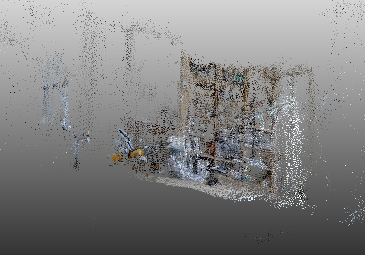
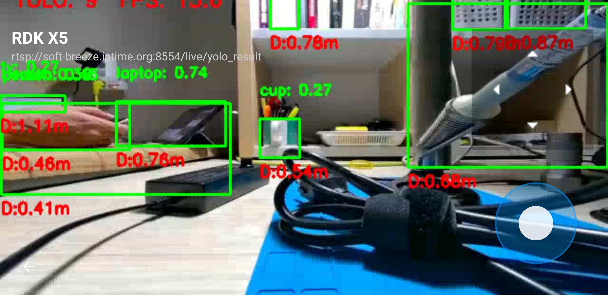
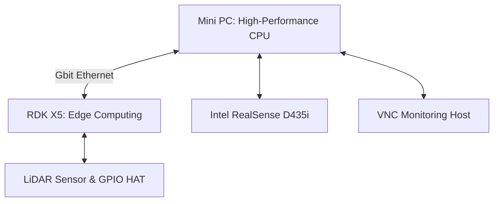

## Why the GS130W Features Make It Unsuitable for RTAB-Map

### 1. RAW Stereo Camera Data Characteristics

> *Note: This is my personal conclusion based on extensive trial and error, as I couldn't find any documentation or prior integration cases for RTAB-Map using the RDK X5 + GS130W setup within the D-Robotics community.*
{: .prompt-info }

In short, I do not believe the GS130W is suitable for RTAB-Map. 

Unlike cameras like the Intel RealSense (e.g., D435i), which natively publish ready-to-use RGB-D data formats suited for RTAB-Map processing at higher hardware-accelerated frame rates, the GS130W outputs extremely raw data. Its default output format is **NV12**, requiring explicit conversion to RGB format before consumption. Furthermore, handling frame-level temporal synchronization between the left and right camera streams presents another hurdle.

This necessary data preprocessing consumes significant compute resources. As a result:
* The publishing FPS of topics required by RTAB-Map drops drastically.
* Combining conversion overhead with heavy RTAB-Map computation on the RDK X5 introduces frustratingly severe lag when rendering maps in the `rtabmap` UI.

### 2. High Initial CPU & BPU Overhead

While hardware on the RealSense D435i processes and formats sensor data internally before output, the GS130W relies heavily on the host SBC's hardware resources (CPU and BPU) right from the start. Consequently, the converted image streams arrive at the RTAB-Map input pipeline already severely degraded in frame rate.

### 3. Network Latency & RDK X5 System Bottlenecks

Beyond color space conversion overhead, handling high-volume Point Cloud data overwhelms the hardware. During testing, remote viewing via VNC Viewer was barely functional. Running compute-heavy GUI environments like `rtabmap` or `rviz2` directly on the local RDK X5 host creates prohibitive processing bottlenecks.

---

## Performance Comparison & Operational Nuances

### 1. GS130W vs. Intel RealSense D435i: Key Differences

While both sensors can feed stereo data into a ROS 2 visual odometry pipeline, distinct operational differences separate the GS130W from the Intel RealSense D435i:

* **Active IR vs. Passive Stereo:** The RealSense D435i features an integrated infrared (IR) projector that actively projects dot patterns onto featureless surfaces (such as plain white walls). This allows it to maintain robust tracking even in low-light or low-texture environments.
* **Lighting Sensitivity:** In contrast, the GS130W relies entirely on ambient lighting and natural visual features. As observed during late-night testing sessions, toggling room lights mid-mapping triggers sharp auto-exposure shifts. This leads to sudden optical flow matching failures and temporary tracking loss (`Not enough inliers`).

### 2. Practical Optimization Tips for Embedded SLAM

Running heavy 3D SLAM algorithms on resource-constrained platforms frequently leads to latency spikes, queue backlogs, and lost tracking. Here are essential strategies to stabilize the pipeline:

#### A. Mitigate Wi-Fi Bottlenecks (VNC Viewer)
Streaming raw image topics and visualization data over wireless networks (e.g., using VNC Viewer) introduces severe latency and network congestion.

> **Tip:** Run core SLAM nodes directly on the robot/host machine or use a tethered wired Ethernet connection to prevent timestamp drift and message queue delays.
{: .prompt-tip }

#### B. Manage Hardware Load via Controlled Teleoperation
High-density stereo odometry and feature extraction (`stereo_odometry`) are computationally expensive. Sudden, jerky movements cause immediate tracking loss.

> **Tip:** Drive the robot or camera slowly using keyboard teleoperation or manual control. Give optical flow algorithms adequate time to track feature correspondences across consecutive frames.
{: .prompt-tip }

#### C. Fine-Tuning RTAB-Map Parameters
When encountering tracking failure or high update latency, consider adjusting key launcher parameters:

* **Max Disparity (`Stereo/MaxDisparity`):** Adjust the disparity search range to match the depth scale of your environment.
* **Queue Sizes:** If framerates fluctuate, slightly increase `approx_sync_max_interval` and `queue_size`, but keep them constrained enough to drop severely delayed stale packets.
* **Feature Limits:** Cap maximum corner limits (e.g., `GFTT/MaxCorners:=300`) to reduce computational overhead per frame.

---

## Practical Limitations of RDK X5 + GS130W

Practical deployment examples of RTAB-Map on the RDK X5 and GS130W pairing are essentially non-existent—most community projects focus on basic object detection pipelines like YOLO. The heavy point cloud payload, coupled with network throughput constraints, renders remote operations impractical over Wi-Fi.

Based on testing results, the RDK X5's BPU performs well near real-time when accepting direct NV12 inputs for tasks like YOLO inference with depth estimation support. However, **running complex Visual SLAM or RTAB-Map on this specific combination is fundamentally constrained** by camera output characteristics and current SDK capabilities.

---

## Future Roadmap for RTAB-Map Deployments

For RTAB-Map workloads, migrating to a Mini PC paired with a dedicated RGB-D sensor (like the D435i) is a far more practical path. RTAB-Map does not natively leverage hardware accelerators like the RDK's BPU, and offloading heavy point cloud processing across wireless networks introduces substantial latency.

### Proposed Architecture

1. **Primary Compute:** A Mini PC featuring high single-core CPU performance (e.g., Intel Core i9 or AMD Ryzen 7000 series) paired with a RealSense D435i for 3D Visual SLAM.
2. **Co-Processing:** Retain the RDK X5 for LiDAR-based 2D navigation and hardware interfacing.
3. **Interconnect & Monitoring:** Connect the two units via a wired Gigabit Ethernet link, using lightweight remote desktop interfaces (like VNC) purely for visual telemetry.

---

## Conclusion

Acquiring a second-hand RDK X5 (8GB) in near-new condition presented an interesting opportunity to test Visual SLAM using the GS130W as an alternative to traditional LiDAR SLAM. However, the throughput overhead and software pipeline demands quickly highlighted why dedicated active RGB-D hardware like the Intel RealSense D435i commands a premium price.

That said, the **RDK X5 + GS130W** platform excels at BPU-accelerated tasks like YOLO object detection. Thanks to its Raspberry Pi-compatible 40-pin header, existing hardware HATs integrate seamlessly, making custom model deployment on the BPU straightforward and efficient. 

While it didn't fit the Visual SLAM use case, the troubleshooting process offered valuable hands-on insights into embedded ROS 2 video pipelines.

---